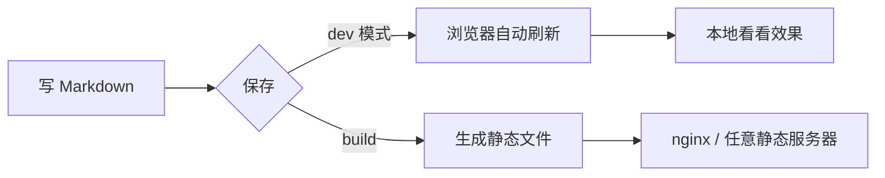
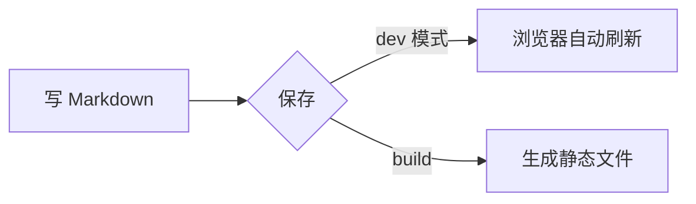
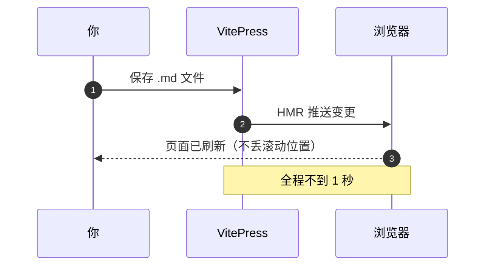
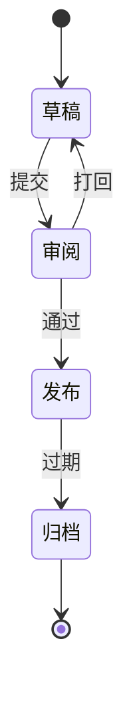
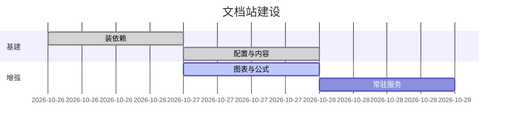
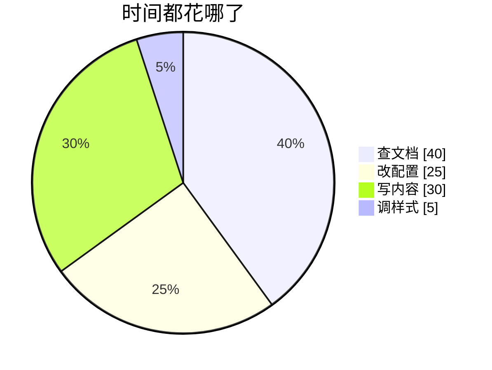
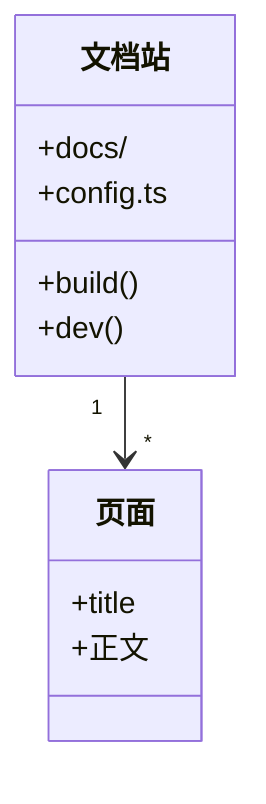

# 图表与公式

这一页的东西全靠插件撑着，但用起来就是普通代码块和 `$` 符号。

## Mermaid 图表

写一个 ` ```mermaid ` 代码块就行。暗色模式下会自动换成深色配色。

### 流程图



````md

````

### 时序图



### 状态图



### 甘特图



### 饼图



### 类图 / 思维导图也能画



::: tip 画图语法速查
Mermaid 官方文档：[mermaid.js.org/intro/syntax-reference](https://mermaid.js.org/intro/syntax-reference.html)。左边选图类型，右边就有可跑的示例。
:::

## 数学公式

用 `markdown: { math: true }`，底层是 MathJax。

**行内**：质能方程 $E = mc^2$，欧拉恒等式 $e^{i\pi} + 1 = 0$。

**块级**（前后各空一行、用两个 `$`）：

$$
\int_{-\infty}^{+\infty} e^{-x^2}\,dx = \sqrt{\pi}
$$

$$
f(x) = \sum_{n=0}^{\infty} \frac{f^{(n)}(a)}{n!}(x-a)^n
$$

$$
\begin{aligned}
\nabla \cdot \mathbf{E} &= \frac{\rho}{\varepsilon_0} \\
\nabla \cdot \mathbf{B} &= 0 \\
\nabla \times \mathbf{E} &= -\frac{\partial \mathbf{B}}{\partial t}
\end{aligned}
$$

::: warning 别乱用美元符号
`math: true` 打开后，正文里成对出现的 `$` 会被当成公式起点。写价钱之类的内容要在 `$` 前加反斜杠转义：`\$100`。
:::

## 图片点击放大

正文里的图片点一下会浮到中间看大图（medium-zoom）。不想让某张图放大，给它加 `no-zoom` class。


